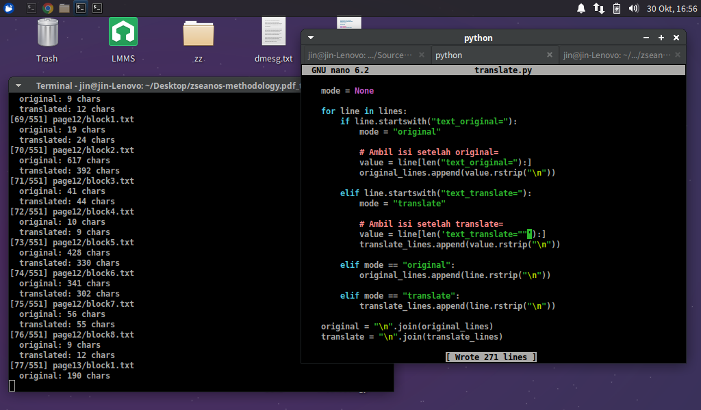
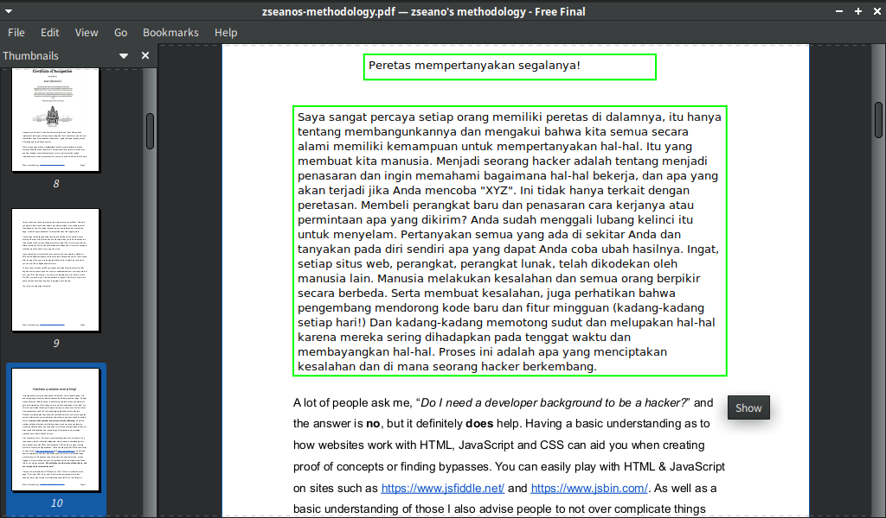

build from xubuntu 22 and version of atril-1.26.0





# usage
```bash
./configure --prefix=`pwd`/install
make
make install

./install/bin/atril tes.pdf
#scroll sampai akhir

cp translate.py tes.pdf_translated
python3 translate.py

NOTE: server google translate harus udah jalan dan bisa diakses dengan
telnet <ip> 9090 lalu atur ROOT_PATH dan ip di translate.py
```
